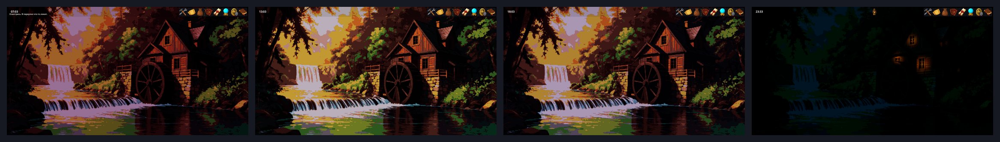
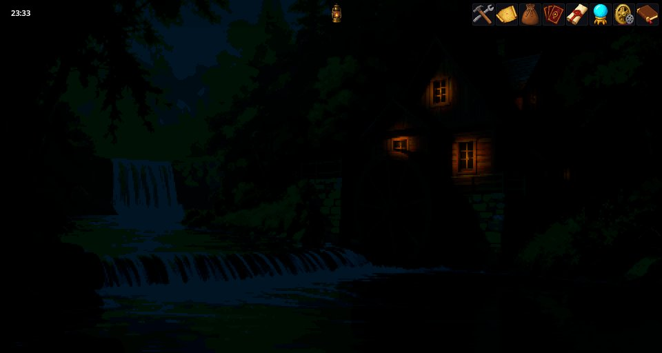
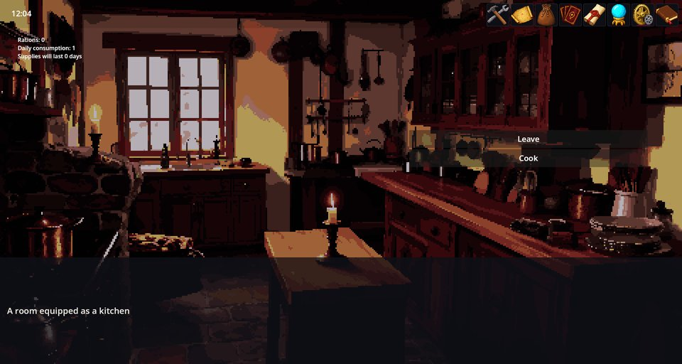
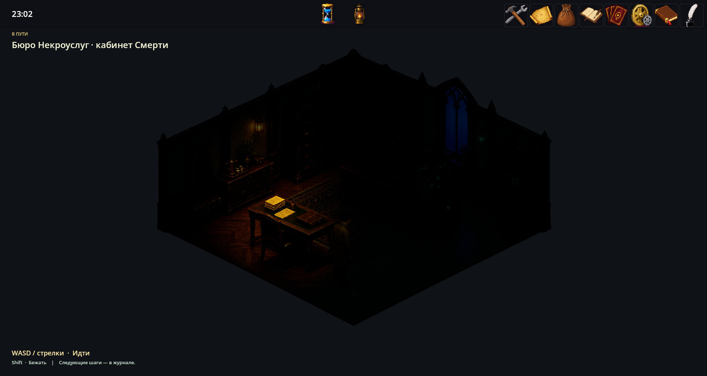

# Time Engine — the game clock, day and night, lights

Time Engine runs the in-game clock and makes scenes follow it: the same place looks different in the morning, at noon, in the evening and at night. It also lights scenes with lamps and windows and gives you a portable lamp after dark. It is an engine mod: games such as Cthangover and the tile-map RPGs include it, and you see its work in every scene rather than as a screen of its own.

## The clock

The time is shown in the top-left corner of the screen. One real second is one game minute, so a game hour passes in a real minute. Some actions take game time at once — for example, cooking or crafting moves the clock forward by the recipe's time.

The calendar is simplified: 30-day months and 12 months a year.

## Day and night

Every scene background is drawn in four moods — **morning**, **day**, **evening** and **night** — and the picture blends smoothly between them:

```text
00 ─── night ─── 04 ⇢ 06 ─ morning ─ 09 ⇢ 11 ──── day ──── 17 ⇢ 19 ─ evening ─ 20 ⇢ 22 ─── night ─── 24
                  (⇢ = a two-hour cross-fade from one mood to the next)
```



## Lights

At night a scene is dark except for its lights. Windows, candles and lamps glow where the scene's author placed them, and each light has its own colour, radius and strength.



**The portable lamp.** In cycle mode it is available from 22:00 to 06:00 when scene lighting is enabled. Fixed night and dark mode also make it available; fixed day hides it regardless of the clock. Drag it from the toolbar onto the picture; click its toolbar icon to stow it.



## For authors

**Place lights in a scene** from its scenario with `light_set` and a list of lights. Positions are fractions of the screen (0 to 1), so they fit any window size; up to 10 lights per scene, plus the portable lamp:

```scenario
light_set [{"x":0.673,"y":0.461,"radius":500,"influence":1,"color":"#ffff00"},{"x":0.135,"y":0.315,"radius":500,"influence":1,"color":"#ffff00"}]
```

- `x`, `y` — position as a fraction of the width and height;
- `radius` — how far the light reaches, in pixels;
- `influence` — strength from 0 to 1;
- `color` — a hex colour.

An empty `light_set` removes the scene's lights. The light editor of Editor Tools places them with the mouse and writes this line for you. The `lighting.clear_map` scenario action turns off a scene's depth lighting when you switch to a scene that does not use it.

**Night-aware backgrounds.** A background lights correctly when it has a depth map next to it, named like the picture with `_depth` (for example `bar.png` and `bar_depth.png`). A background can also have an `_albedo` companion. Without these maps, scene lights have no shape to shine on.

**Other mods** read the same clock: the RPG tile map follows the same day as the backgrounds, and the time's change is announced to every mod once a game minute.

## If something goes wrong

1. **A scene stays bright at night.** Its background has no depth map, or the scene does not use time-of-day shading.
2. **No lantern.** Check the location’s lighting mode and whether scene lighting is enabled; fixed day hides it even at midnight.

## The same portable lamp in Stas's game

The top-center toolbar lamp is shared by novels and RPG maps. Hold its left mouse button, drag it onto the artwork and release: the light stays where dropped. Click its toolbar icon again to stow it, then drag it out again when needed. This is a player inspection tool, not a permanent source written into the map.

`junior_reaper_paper_grief` initially uses fixed daytime on its maps, which hides the lamp. Open **Light Editor → RPG maps**, choose a room (the starting office is `jrp_office`), select **Fixed night**, save, and close the editor. The toolbar lamp becomes available regardless of the clock. **Night preview** affects only the editor and does not change the saved game lighting mode.


