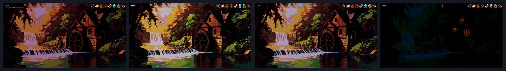
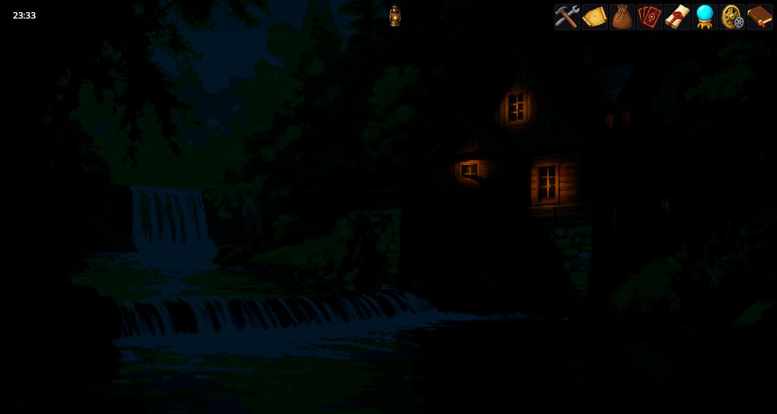

# Time Engine — đồng hồ trong game, ngày đêm và ánh sáng

Time Engine vận hành đồng hồ trong game và khiến các cảnh đi theo nó: cùng một địa điểm nhưng sáng, trưa, chiều và đêm trông khác nhau. Nó còn thắp sáng cảnh bằng đèn và cửa sổ, và sau khi trời tối đưa cho bạn một chiếc đèn cầm tay. Đây là mod engine: các game như Cthangover và các game RPG tile đều có nó, và thành quả của nó hiện ra trong từng cảnh thay vì trên một màn hình riêng.

## Đồng hồ

Thời gian hiển thị ở góc trên bên trái màn hình. Một giây thực tế bằng một phút trong game, nên một giờ trong game trôi qua trong một phút thực tế. Một số hành động tốn thời gian game ngay lập tức — ví dụ nấu ăn hay chế tạo sẽ đưa đồng hồ tiến lên đúng bằng thời gian của công thức.

Lịch được đơn giản hóa: tháng 30 ngày, một năm 12 tháng.

## Ngày và đêm

Nền của mỗi cảnh được vẽ theo bốn trạng thái — **buổi sáng**, **ban ngày**, **buổi chiều** và **ban đêm** — và bức tranh chuyển mượt giữa chúng:

```text
00 ─ đêm ─ 04 ⇢ 06 ─ sáng ─ 09 ⇢ 11 ─── ngày ─── 17 ⇢ 19 ─ chiều ─ 21 ⇢ 22 ── đêm ── 24
                  (⇢ = khoảng hòa trộn hai giờ từ trạng thái này sang trạng thái kế tiếp)
```



## Ánh sáng

Ban đêm cảnh tối trừ những đèn của nó. Cửa sổ, nến và đèn tỏa sáng đúng chỗ tác giả cảnh đặt chúng, và mỗi ngọn đèn có màu sắc, bán kính, cường độ riêng.



**Đèn cầm tay.** Từ 22:00 đến 06:00, một chiếc đèn lồng xuất hiện phía trên màn hình. Kéo nó ra giữa cảnh để soi vào chỗ bạn muốn nhìn.


## Cho tác giả

**Đặt đèn vào một cảnh** từ kịch bản của cảnh bằng `light_set` cùng danh sách đèn. Vị trí tính theo tỉ lệ màn hình (0 đến 1) nên vừa với mọi kích thước cửa sổ; tối đa 10 đèn mỗi cảnh, chưa kể đèn cầm tay:

```scenario
light_set [{"x":0.673,"y":0.461,"radius":500,"influence":1,"color":"#ffff00"},{"x":0.135,"y":0.315,"radius":500,"influence":1,"color":"#ffff00"}]
```

- `x`, `y` — vị trí theo tỉ lệ chiều rộng và chiều cao;
- `radius` — ánh sáng vươn xa đến đâu, tính bằng pixel;
- `influence` — cường độ từ 0 đến 1;
- `color` — màu dạng hex.

`light_set` rỗng xóa hết đèn của cảnh. Trình soạn đèn của Editor Tools đặt chúng bằng chuột và viết sẵn dòng lệnh này cho bạn. Hành động kịch bản `lighting.clear_map` tắt ánh sáng theo chiều sâu của một cảnh khi bạn chuyển sang cảnh không dùng nó.

**Nền biết đêm.** Nền được chiếu sáng đúng cách khi cạnh nó có một bản đồ chiều sâu, đặt tên trùng hình ảnh kèm `_depth` (ví dụ `bar.png` và `bar_depth.png`). Nền cũng có thể kèm thêm một bản `_albedo`. Thiếu các bản đồ này, đèn trong cảnh không có hình dáng nào để đổ sáng lên.

**Các mod khác** cùng đọc một chiếc đồng hồ: bản đồ tile của RPG đi theo cùng một ngày với các nền, và cứ mỗi phút trong game, sự thay đổi thời gian lại được báo cho mọi mod.

## Khi có trục trặc

1. **Cảnh vẫn sáng vào ban đêm.** Nền của nó không có bản đồ chiều sâu, hoặc cảnh không dùng sắc màu theo thời gian.
2. **Không có đèn lồng vào ban đêm.** Nó chỉ xuất hiện từ 22:00 đến 06:00 và chỉ trong những game có giao diện chứa nó.
